 

  

---

## 🛠️ Tech Stack

**Backend** 

**Frontend** 

**Databases** 

**Cloud & Tools** 

**Data & Languages** 

**Concepts** 

---

## 📊 GitHub Stats

  

  

<!--
  SNAKE (uncomment AFTER the "Generate Snake" workflow has run once):
    
  <picture>
    <source media="(prefers-color-scheme: dark)" srcset="https://raw.githubusercontent.com/AlgoArchitect3005/AlgoArchitect3005/output/github-snake-dark.svg" />
    
  </picture>
-->

---

## 🤝 Let's Connect

  
  
  

 

