<picture>
  <source media="(prefers-color-scheme: dark)" srcset="./dark.svg">
  <source media="(prefers-color-scheme: light)" srcset="./light.svg">
  
</picture>

## Hi, I'm Yash 👋

Full-Stack Developer who builds REST APIs with **Java and Spring Boot**, pairs them with **React** frontends, and uses **Python (FastAPI)** where it fits. I care about clean API design, secure authentication, and shipping with a proper CI/CD pipeline.

## What I focus on

- **Backend:** RESTful API design with Spring Boot, secured with Spring Security, JWT authentication, RBAC and BCrypt password hashing
- **Frontend:** React.js with Vite
- **Python:** FastAPI services and NumPy
- **Quality & delivery:** Git, GitHub Actions, CI/CD, SonarQube, Postman, Maven
- **Infra:** Docker, AWS

## Engineering stack

| Area | Technologies |
| --- | --- |
| Languages | `Java` `C` `C++` `JavaScript` `Python` `HTML` `CSS` |
| Frameworks & libraries | `Spring Boot` `Spring Security` `React.js` `Vite` `FastAPI` `NumPy` |
| Databases | `MongoDB` `PostgreSQL` `MySQL` |
| Cloud & DevOps | `Docker` `AWS` `GitHub Actions` `CI/CD` |
| Tools | `Git` `GitHub` `Maven` `Postman` `SonarQube` `VS Code` |
| Concepts | `RESTful API Design` `JWT Authentication` `RBAC` `BCrypt` `Spring Profiles` |

<!--
## Featured projects

Uncomment this section once you have projects you want to show.

| Project | What it is |
| --- | --- |
| [Project name](https://github.com/AlgoArchitect3005/REPO) | One short factual line |
-->

## GitHub activity

<picture>
  <source media="(prefers-color-scheme: dark)" srcset="https://github-readme-stats.vercel.app/api?username=AlgoArchitect3005&show_icons=true&theme=transparent&hide_border=true&title_color=22D3EE&icon_color=7C3AED&text_color=E2E8F0">
  
</picture>

## Connect

- GitHub: [@AlgoArchitect3005](https://github.com/AlgoArchitect3005)
- Threads: [@007yash_x24](https://www.threads.com/@007yash_x24)
<!-- Uncomment after replacing the placeholders with your real details:
- LinkedIn: [your name](https://www.linkedin.com/in/YOUR-LINKEDIN-ID)
- Twitter / X: [@YOUR_HANDLE](https://x.com/YOUR_HANDLE)
- Email: [YOUR_EMAIL@gmail.com](mailto:YOUR_EMAIL@gmail.com)
-->
